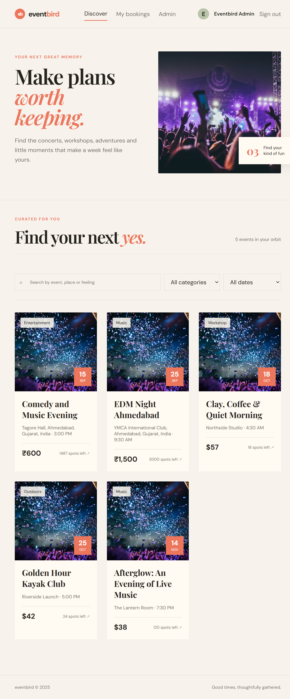
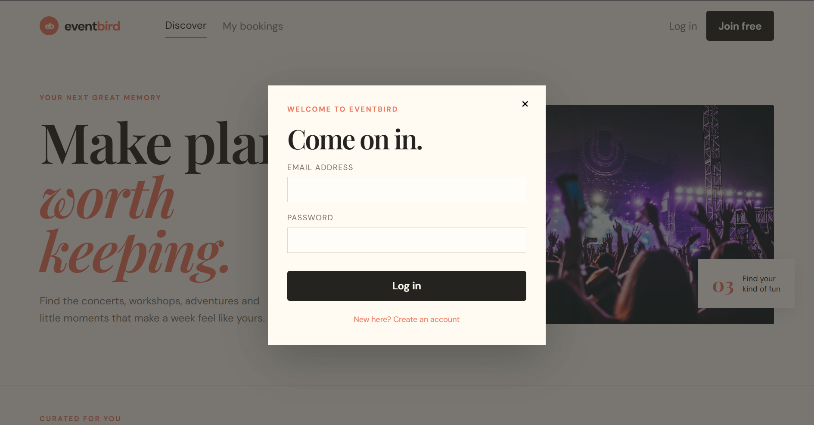
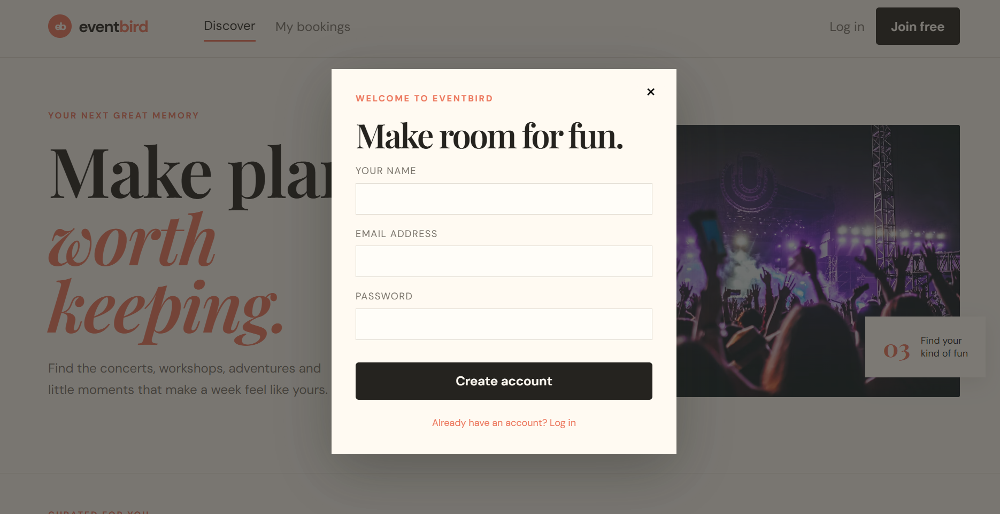
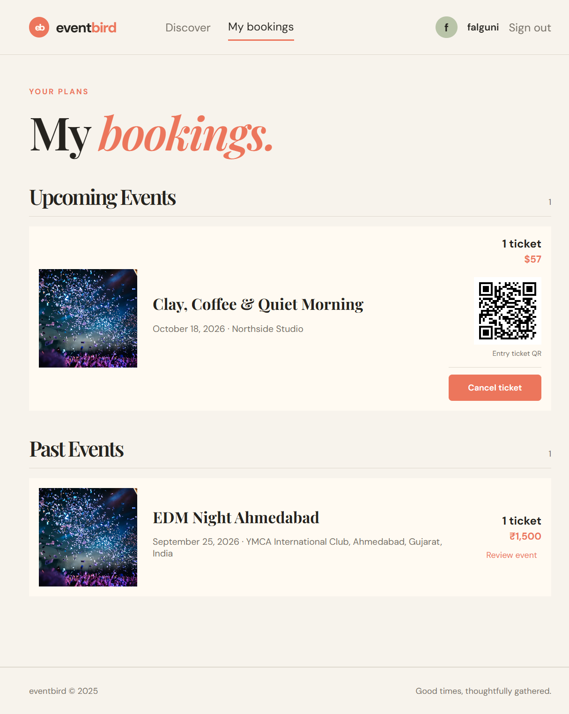
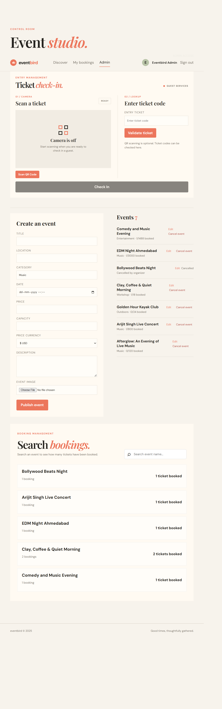
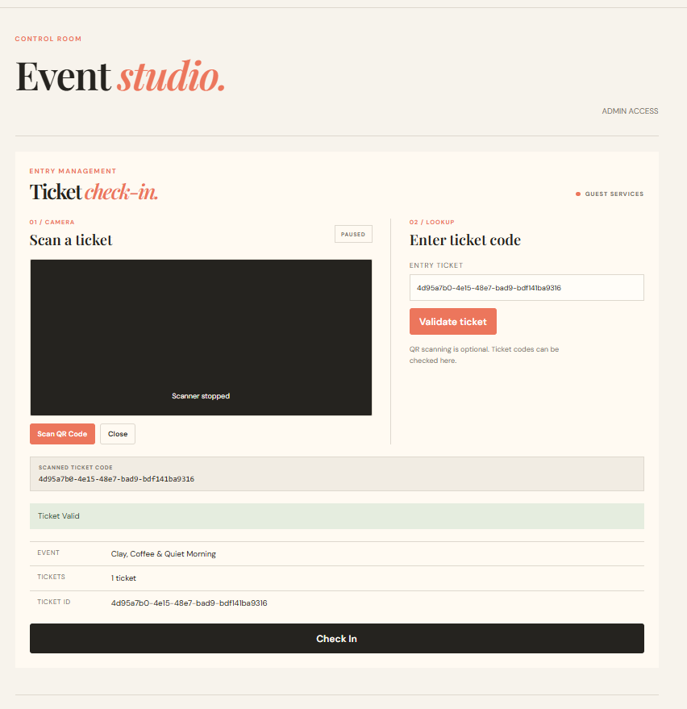

# eventbird

A full-stack MERN event ticketing and experience booking platform.

---

## Features

### User Features

- User registration and login
- Browse upcoming events
- Search and filter events
- View event details
- Book event tickets
- Cancel eligible bookings after 72 hours, subject to the event-date cutoff
- Reserve event tickets and pay cash at the venue
- Receive QR-code tickets and admission check-in
- Review and rate events after a confirmed booking and event completion
- Opt in to 24-hour email event reminders
- View booking history
- User authentication with JWT

--- 

### Admin Features

- Admin login
- Create events
- Edit events
- Cancel events without deleting event or booking records
- Upload event images
- Manage event details
- View event bookings
- View sales, ticket, revenue, and event-capacity analytics
- Scan QR-code tickets
- Check in guests
- Prevent duplicate ticket check-ins

---

## Screenshots

### Home Page


### Login Page


### Registration Page


### Booking Page


### Admin Dashboard


### Ticket Check-In
After scanning the QR code, the ticket is successfully validated and checked in.


---

## Technologies Used

### Frontend

- React
- Vite
- Axios
- CSS

---

### Backend
- Node.js
- Express.js
- MongoDB
- Mongoose
- JWT Authentication
- bcryptjs
- Multer
- CORS

---

## Project Structure

```text
event-booking/
│
├── frontend/
│   ├── src/
│   ├── public/
│   ├── package.json
│   └── ...
│
├── backend/
│   ├── models/
│   ├── routes/
│   ├── middleware/
│   ├── uploads/
│   ├── server.js
│   ├── seed.js
│   ├── package.json
│   └── ...
│
├── README.md
└── package-lock.json
```

## Run locally

### Prerequisites: 

- Node.js 18+
- MongoDB running locally
- npm

---

### Installation and Setup

1. Clone the repository
```bash
git clone https://github.com/FalguniRathod-07/Week4_MERN
cd event-booking
```

2. Backend Setup

Open PowerShell and run:
```bash
cd backend
npm install
```
---

Create the environment file:
```bash 
copy .env.example .env
```

Cash-at-venue bookings do not require payment-provider credentials.

If email reminders are enabled, configure the SMTP settings in backend/.env.

3. Seed the Database

npm run seed script:
```bash
npm run seed
```
The seed script creates the default admin account for local development.

4. Start the backend:
```bash
npm run dev
```

The backend will run on:
http://localhost:5000

---

5. Frontend Setup

Open a new PowerShell terminal and run:
```bash 
cd frontend
npm install
npm run dev
```

The frontend will normally run on:
http://localhost:5173

---

### Admin Login

The seed script creates a default admin account for local development.

- Email: `admin@eventbird.local`
- Password: `admin123`

---

Admins can:

-Create events
-Edit events
-Cancel events
-Upload event images
-Scan QR-code tickets
-Validate ticket codes
-Check in guests
-Prevent duplicate ticket check-ins

---

## Application Flow

### User Flow

<pre>
User
├── Register
├── Login
├── Browse Events
├── Search / Filter Events
├── View Event Details
├── Book Tickets
├── Receive QR Ticket
└── View My Bookings
    ├── Cancel Eligible Booking
    ├── Receive Event Reminder
    └── Review / Rate Completed Event
</pre>

### Admin Flow

<pre>
Admin
├── Login
├── Admin Dashboard
├── Create Event
├── Edit Event
├── Cancel Event
├── Upload Event Image
├── View Booking Summary
├── Search Bookings
├── Scan QR Code
├── Validate Ticket
└── Check In Guest
</pre>

---

## Authentication

The application uses JWT-based authentication.
Users and admins have role-based access to protected features.
Passwords are securely hashed using bcryptjs.

---

## Ticket Check-In

Each confirmed booking receives a unique QR-code ticket.

Admins can:

- Scan the customer's QR code.
- Validate the ticket.
- View the ticket information.
- Check the guest in.
- Prevent the same ticket from being checked in more than once.

Manual ticket-code validation is also available if QR scanning is not used.

---

## Reviews and Ratings

Users can review and rate an event after:

- Having a confirmed booking
- The event has been completed
- Email Reminders

Users can opt in to receive an email reminder approximately 24 hours before an event.

SMTP configuration is required in backend/.env for email reminders.

---

## Future Changes

- Online payment gateway integration
- Real-time event notifications
- Advanced admin analytics and reporting
- Advanced admin analytics and reporting
- Multiple ticket types and pricing
- Seat selection for supported events
- QR-code based event entry improvements
- Mobile-responsive and Progressive Web App (PWA) support

## Author

Falguni Rathod

---

## License

This project is created for educational and internship purposes.